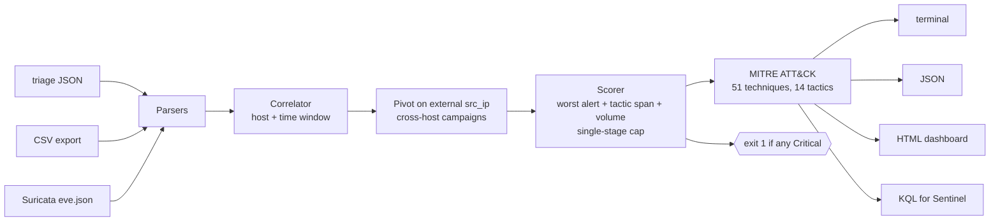
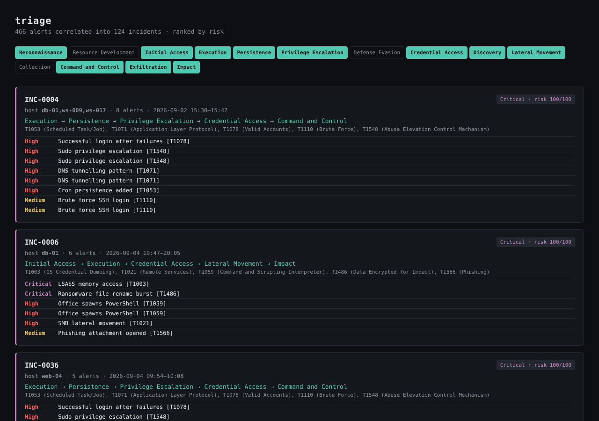

# triage

[](https://github.com/jcedrik/triage/actions/workflows/ci.yml)
[](LICENSE)


A SOC alert correlation engine. Takes a pile of IDS and endpoint alerts,
collapses them into a short list of incidents, scores each one 0 to 100, maps
it onto the MITRE ATT&CK kill chain, and hands you the one you should open
first.

```
triage eve.json --pivot-src-ip --html dashboard.html --kql hunt.kql
```





## Numbers

Measured on labelled datasets where every alert is tagged *attack* or
*benign* and the engine never sees the tag ([`bench/RESULTS.md`](bench/RESULTS.md)).

| Dataset | Alerts | Incidents | Reduction | Campaign recall | False-positive rate | Precision@10 |
|---|---:|---:|---:|---:|---:|---:|
| one week, 14 intrusions, 24 noise sources | 466 | 124 | 3.8x | 100 % | 0 % | 100 % |
| one month, 52 intrusions, 101 noise sources | 1,899 | 552 | 3.4x | 100 % | 0 % | 100 % |

*False-positive rate* is the share of benign-only incidents that get scored
High or Critical, which is the share an analyst would open for nothing.
Before the single-stage cap it was 10.9 %: every nightly backup job looked like
exfiltration. The benchmark runs in CI and fails the build if recall drops or
the false-positive rate climbs above 5 %.

The data is synthetic and the generator is small, so read these as a
regression gate, not as production detection rates. Next step is feeding
real Atomic Red Team runs through Suricata into the engine, which is why the
EVE parser exists.

## Install and run

```bash
pip install -e .
triage samples/alerts.json                       # 8 alerts -> 3 incidents, the real one at 100
triage samples/eve.json                          # Suricata, auto-detected
triage alerts.json --pivot-src-ip                # merge cross-host activity from one attacker
triage alerts.json --html dash.html --json out.json --kql hunt.kql
```

| Flag | Default | What it does |
|---|---|---|
| `--window MIN` | 30 | quiet gap after which a new incident starts on the same host |
| `--pivot-src-ip` | off | merge incidents on different hosts that share an external source IP and overlap in time |
| `--format` | auto | `json`, `csv` or `suricata`; auto sniffs the file |
| `--json FILE` | | machine-readable report |
| `--html FILE` | | self-contained dashboard |
| `--kql FILE` | | one Microsoft Sentinel hunting query per incident |
| `--quiet` | | no terminal summary |

Exit code `1` when any incident is Critical, so it gates a pipeline.

## Input formats

**Native JSON**, a list of objects. `timestamp`, `host`, `signature`,
`severity` are required; `technique_id`, `category`, `src_ip`, `dst_ip`,
`raw` are optional. Unknown fields are ignored, which is how the benchmark
datasets carry their labels in the same file.

**CSV** with the same fields as columns.

**Suricata `eve.json`**: newline-delimited, only `event_type: alert` is
read. Severity 1 to 4 maps to Critical to Low. The ATT&CK id is taken from
the rule metadata (`mitre_technique_id`, which ET Open rules carry) or, failing
that, from a `T1234` token in the signature. Sub-techniques roll up to the
parent. The attacked host is `dest_ip` unless the record has a `host` field.

## How it decides

**Correlation** is host plus time window: alerts on one host keep joining the
same incident until there is a quiet gap longer than the window. With
`--pivot-src-ip`, a second pass unions incidents on different hosts that
share a non-internal source IP and overlap in time. RFC 1918, loopback and
link-local addresses are never pivoted on, otherwise a proxy or a jump host
would glue the whole estate into one incident.

**Scoring** is explainable on purpose: base points from the worst alert
(Info 5, Low 15, Medium 35, High 60, Critical 80), +8 per additional ATT&CK
tactic, +2 per alert capped at 16. One rule learned from the benchmark: an
incident made of a single signature in a single tactic is capped at 59
(Medium) unless that alert is Critical. That is what separates a backup job
from an intrusion.

**MITRE mapping** covers 51 techniques across all 14 enterprise tactics,
listed in [`docs/MITRE.md`](docs/MITRE.md). Tactics are sorted in kill-chain
order so the report reads as a story: Initial Access, Execution, Credential
Access, Exfiltration.

## Into Sentinel

`--kql` writes one hunting query per incident against the `SecurityAlert`
table, scoped to the incident's hosts, source IPs, time span and techniques.
Open it in Microsoft Sentinel, run it, and you are looking at the same
incident in the SIEM. Adjust the table name for your connector.

## Benchmark

```bash
python bench/generate_dataset.py --days 7 --seed 42 --out bench/data/week.json
python bench/evaluate.py bench/data/week.json --pivot-src-ip
```

`generate_dataset.py` draws from four attack chains and four benign noise
patterns (authorised scanner, flapping signature, misconfigured client,
backup job) with a seed. `evaluate.py` reports reduction, campaign recall,
false-positive rate, purity and precision@10. Change the scorer, re-run,
and you know what you broke.

## Layout

```
triage/
  models.py      Alert and Incident
  parsers.py     JSON, CSV, Suricata EVE
  correlator.py  host+time grouping, src_ip pivot
  scorer.py      risk score and severity
  mitre.py       technique -> tactic
  report.py      terminal, JSON, HTML, KQL
  cli.py
bench/           labelled datasets, generator, evaluator, RESULTS.md
tests/           20 tests: correlation, pivot, scoring cap, parsers, KQL
```

## Next

- Replay Atomic Red Team runs from the Purple Team lab through Suricata and
  Elastic, feed the real `eve.json` here, and publish those numbers.
- Correlate on technique chains, not only on host and source IP, to catch
  slow intrusions that stay under the time window.
- Streaming mode for a live `eve.json`.

## License

MIT
